<div align="center">

<a href="https://ai.aeroscan.co.za/download">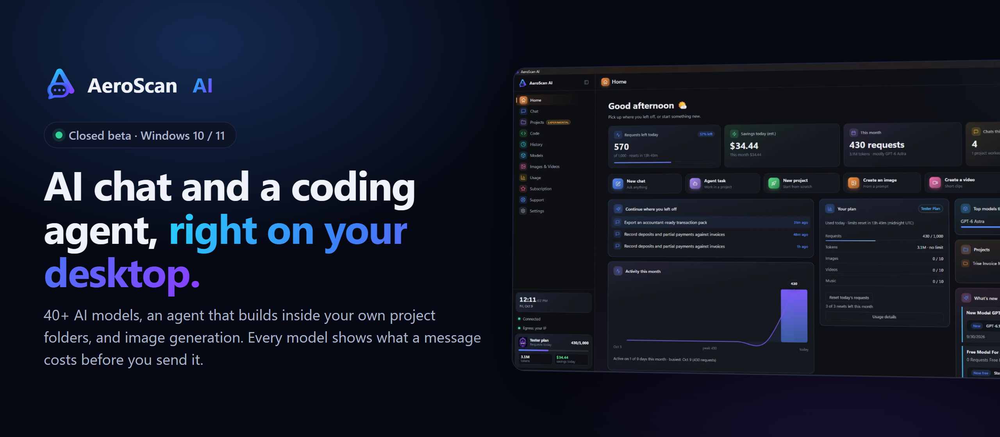</a>

<a href="https://github.com/adminaeroscan/aeroscan-beta/releases/download/v1.0.0-beta.10/AeroScan.AI-Beta-Setup-1.0.0-beta.10-x64.exe">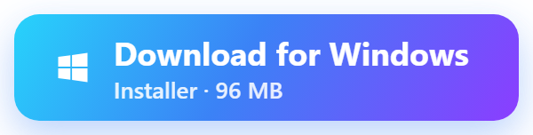</a>
<a href="https://github.com/adminaeroscan/aeroscan-beta/releases/download/v1.0.0-beta.10/AeroScan.AI-Beta-Portable-1.0.0-beta.10-x64.exe">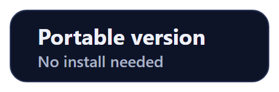</a>
<a href="https://ai.aeroscan.co.za/download">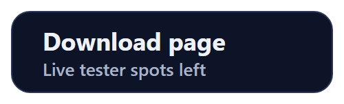</a>
<a href="https://discord.gg/DWYhRmu9Dz"></a>

<sub>Version 1.0.0-beta.10 · Windows 10 / 11, 64-bit · Free during the beta · <a href="https://github.com/adminaeroscan/aeroscan-beta/releases/latest">All releases</a></sub>

</div>

<br>

### NEW IN BETA 10
## A live preview that works first time, a live Support page and videos that stay

- 👁️ **Preview works on the first run**: start your app from the Preview tab and it shows straight away, not only on the second try.
- 🛟 **Support is live**: news from support arrives within seconds, the number of unread reports shows next to Support, and an open report updates by itself.
- 🎞️ **Videos stay after a restart**: finished videos are saved on your computer (the newest 30) and are there when you open the app again.
- 🎬 **Smoother video generation**: live progress while a video starts, and big reference pictures are shrunk instead of being refused.

Beta 9 brought **the new-site wizard, a more alive Desk widget and a calmer start-up**. Beta 8 brought **Design mode, the agent on a server over SSH and linked folders**. Beta 7 brought **specs, Focus windows and a phone remote**. Beta 6 made **the agent get on with it**. Beta 5 brought **update checks at start-up** and a **Files tab** in agent mode. Beta 4 brought **chat that reads the web and cites its sources**.

<br>

### GET STARTED
## Up and running in two minutes

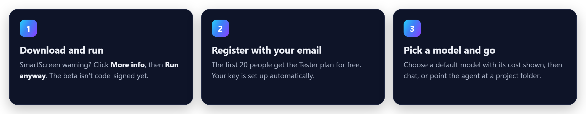

<br>

### WHAT YOU GET
## Everything in one window

No browser tabs, no copy-pasting code. Work happens on your own machine, in your own folders.

#### Agent mode: an agent that works in your project

Give it a task and it plans, edits files, runs your tests and reports back.

- ✅ Reads, writes and builds in a folder you choose
- ✅ Review, undo or commit every change it makes
- ✅ Stops when the checks pass, so it doesn't waste requests

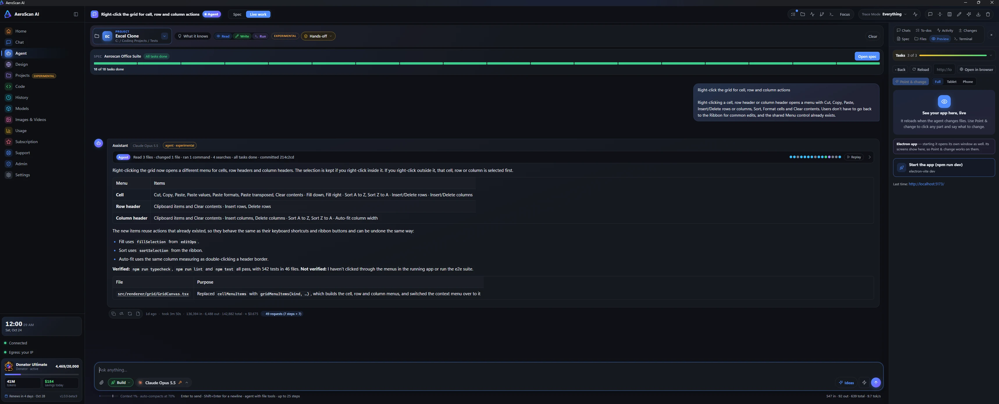

#### Spec mode: plan it first, then build it task by task

Describe a feature and get requirements, a design and a task list. Then build the tasks one at a time, or all of them, and watch each one tick off with its files, cost and commit.

- ✅ Requirements, design and tasks you can read and edit
- ✅ Every task shows its changed files, time, requests and commit
- ✅ Review the changes of any task, or build the rest in one go

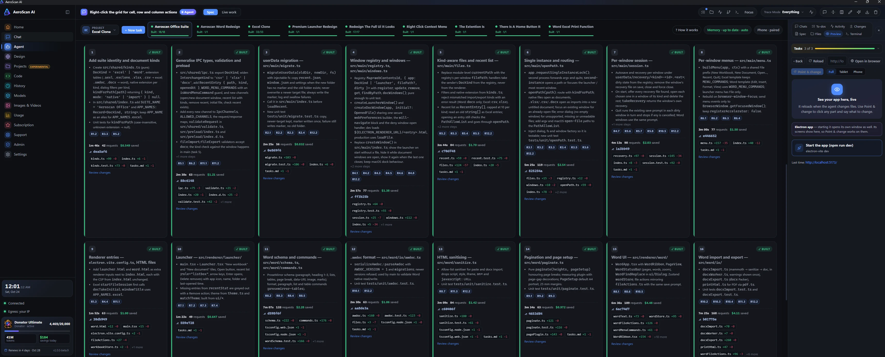

#### Live preview: point at the part you want changed

The agent reloads your running app as it works. Use Point & change to click any part of it, say what should be different, and send it to the agent. Electron apps open in their own window too.

- ✅ Click an element, then describe the change in words
- ✅ Full, tablet and phone sizes
- ✅ The preview reloads when the agent changes files

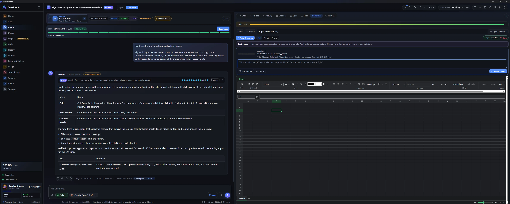

#### Design mode: build a website and watch it appear

Describe a site, or plan it with the wizard, and see it written live. Click any part of the page to change just that part, restyle the whole site, and export it when you are happy.

- ✅ Pages, sections, your own images and a style panel
- ✅ History you can restore, and a check for broken links
- ✅ Desktop, tablet and phone previews

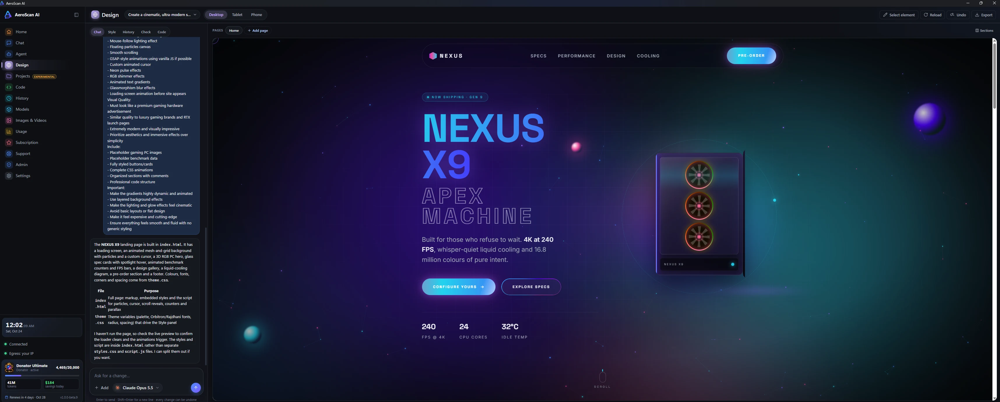

#### Desk widget: follow your agent on a second screen

A widget for another monitor shows what the agent is doing, how far it has got and what it is waiting for. It works in portrait on a 1080p screen and in landscape on a 1440p one, and you can answer the agent from it.

- ✅ Live progress, checks and a clock
- ✅ Approve a step or type a reply from the widget
- ✅ Portrait, landscape, mini and full screen

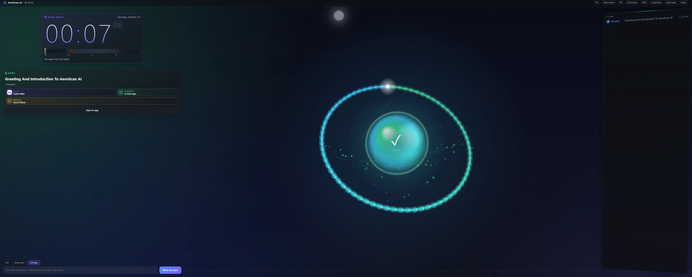

<p align="center">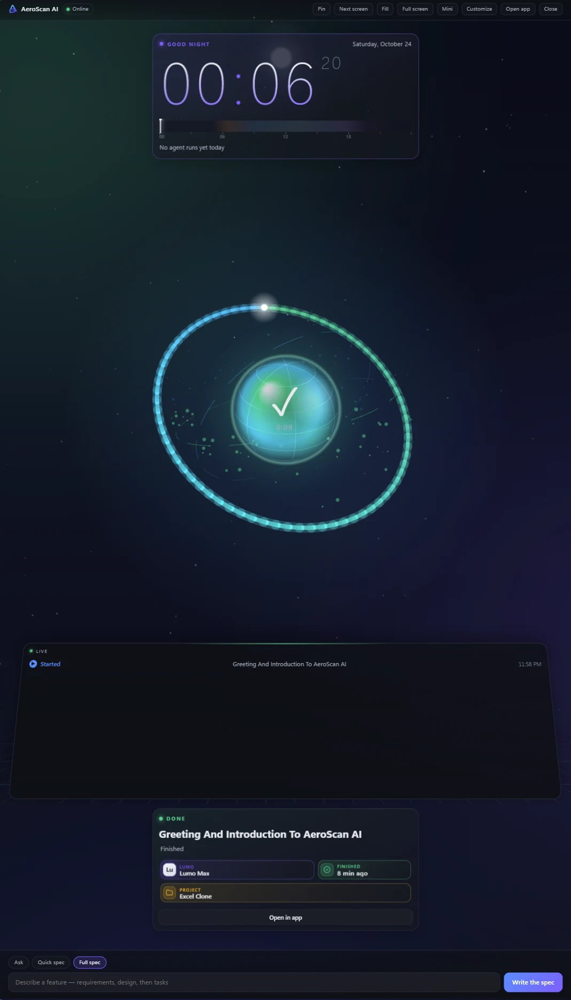</p>

#### Projects: keep each project together

To-dos, milestones, notes, links, chats and agent runs live in one place for each folder. Start an agent chat straight from a to-do.

- ✅ To-dos and milestones with progress
- ✅ A task queue and schedules (Automate): queued to-dos run one at a time in their own copy of the project
- ✅ Feature ideas for your project, one click to build
- ✅ Git status and an AI summary of the project

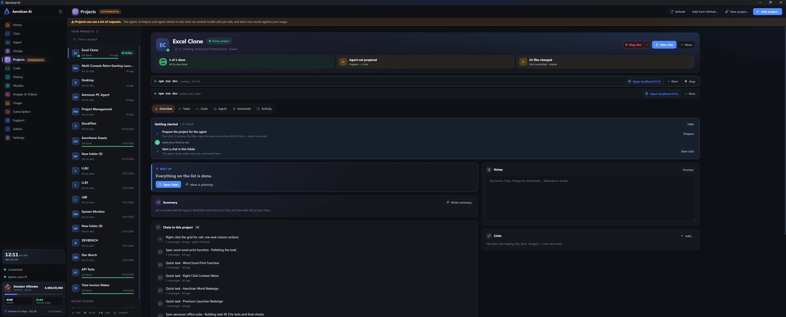

#### A closer look

<table>
<tr>
<td width="33%" valign="top"><a href="docs/chat.png">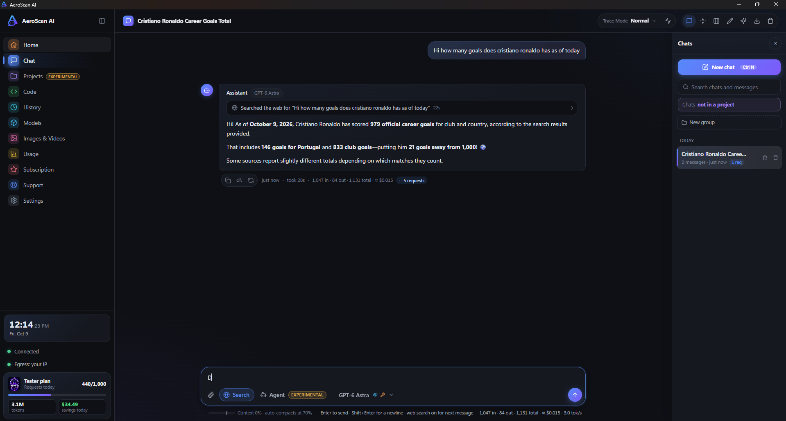</a><br><b>Chat with live web search</b><br><sub>Ask about today and it looks it up, with the cost of every reply shown.</sub></td>
<td width="33%" valign="top"><a href="docs/models.png">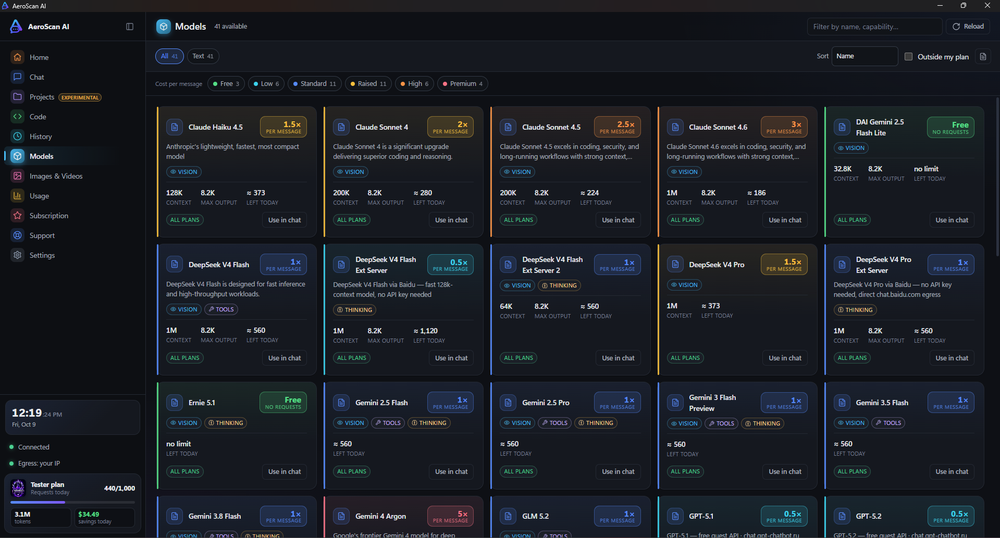</a><br><b>41 models, priced up front</b><br><sub>Filter by cost, vision, tools or thinking before you pick one.</sub></td>
<td width="33%" valign="top"><a href="docs/usage.png">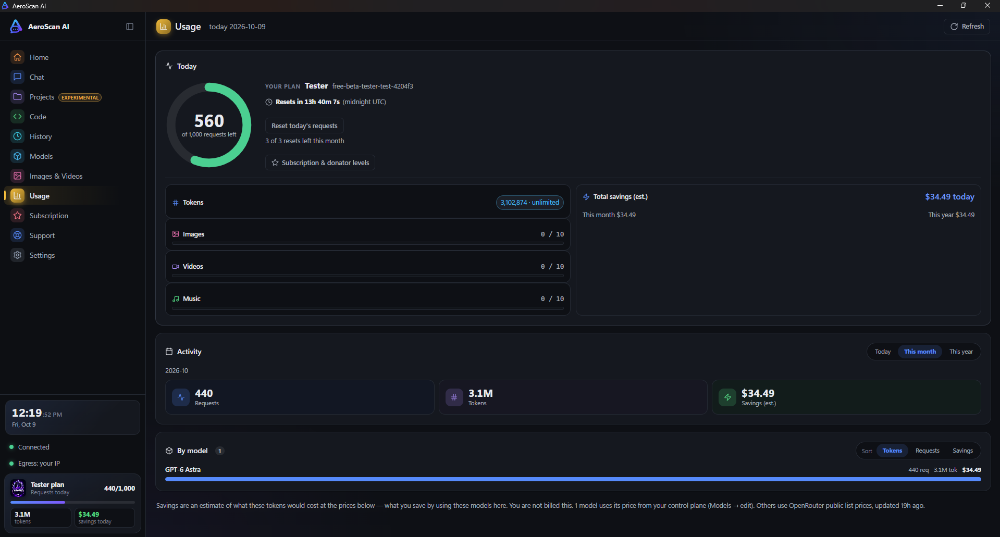</a><br><b>Always know what's left</b><br><sub>Requests left today, resets, and usage by model.</sub></td>
</tr>
<tr>
<td valign="top"><b>40+ models</b><br><sub>Switch models in a click. The cost is shown on every one.</sub></td>
<td valign="top"><b>Images and vision</b><br><sub>Generate images, or paste a screenshot and ask about it.</sub></td>
<td valign="top"><b>Your files stay local</b><br><sub>The agent works in folders you choose, on your PC.</sub></td>
</tr>
</table>

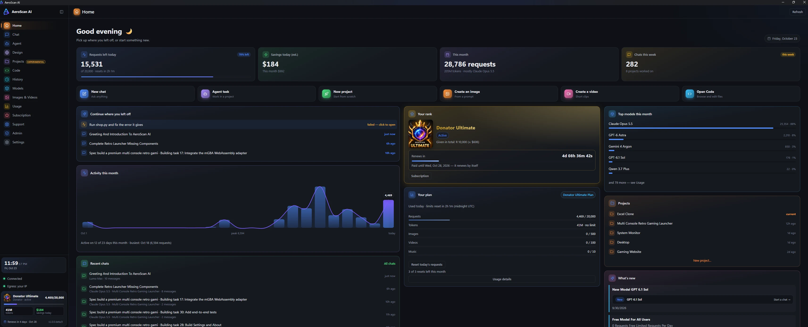

<br>

### CLOSED BETA
## The Tester plan, free for the first 20

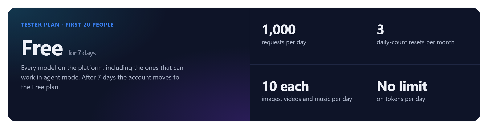

Register in the app while spots are open and you get full access for 7 days, then the account moves to the Free plan. When the 20 spots are gone, registration closes. The **[download page](https://ai.aeroscan.co.za/download)** shows how many are left, live.

<br>

### MODELS
## What each model costs

A chat message uses the number of requests shown. In agent mode, every step uses that many, so a 10-step task on a 3-request model uses 30. Free models never use a request.

<details>
<summary><b>Chat models (60)</b>: sorted by cost</summary>

| Model | Requests per message | Vision | Agent mode |
|---|---:|:---:|:---:|
| Auto Free | Free | - | - |
| Beam 1.0 | Free | - | - |
| Comfy 35B | Free | - | - |
| DeepSeek V4.1 Flash | Free | Yes | - |
| Ernie 5.1 | Free | Yes | - |
| Flint | Free | Yes | Yes |
| GLM 5.3 Flash | Free | Yes | - |
| Glyph Cluster | Free | Yes | - |
| Laguna S 2.1 | Free | Yes | - |
| LFM2.5-2.6B | Free | Yes | - |
| MiniMax M2.5 | Free | Yes | - |
| Nemotron 3 Ultra | Free | Yes | Yes |
| Nemotron 3.5 Lightning | Free | Yes | Yes |
| Nemotron 3.5 Super VL | Free | Yes | Yes |
| North Mini Code | Free | Yes | - |
| OpenRouter Free Models Router | Free | Yes | - |
| Qwen 3.8 Flash | Free | Yes | - |
| Reka Flash | Free | Yes | - |
| Tencent Hy3 | Free | - | - |
| DeepSeek V4 Flash Ext Server | 0.5 | - | - |
| GPT-5.1 | 0.5 | Yes | - |
| GPT-5.2 | 0.5 | Yes | - |
| GPT-5.4 Mini | 0.5 | Yes | - |
| GPT-5.4 Nano | 0.5 | Yes | - |
| DeepSeek V4 Flash | 1 | Yes | - |
| DeepSeek V4 Flash Ext Server 2 | 1 | Yes | - |
| DeepSeek V4 Pro Ext Server | 1 | - | - |
| DeepSeek V4 Pro Ext Server 2 | 1 | Yes | - |
| Gemini 2.5 Flash | 1 | Yes | - |
| Gemini 2.5 Pro | 1 | Yes | - |
| Gemini 3 Flash Preview | 1 | Yes | - |
| Gemini 3.5 Flash | 1 | Yes | - |
| Gemini 3.8 Flash | 1 | Yes | Yes |
| GLM 5.2 | 1 | Yes | - |
| Mercury 2.5 Preview | 1 | Yes | - |
| MiniMax M2.7 | 1 | Yes | - |
| Muse Spark 1.2 | 1 | Yes | - |
| Grok 4.20 | 1.2 | Yes | - |
| Grok 4.3 | 1.3 | Yes | - |
| Claude Haiku 4.5 | 1.5 | Yes | - |
| DeepSeek V4 Pro | 1.5 | Yes | - |
| Grok Build 0.1 | 1.5 | Yes | - |
| Qwen 3.7 Plus | 1.5 | Yes | Yes |
| Qwen 3.8 Omni Flash | 1.7 | Yes | Yes |
| GPT-5.6 Luna V1 | 2 | Yes | Yes |
| MiniMax M3 | 2 | Yes | - |
| Qwen 3.8 Max | 2 | Yes | Yes |
| Claude Sonnet 4.5 | 2.5 | Yes | - |
| GPT-6 Luna | 2.5 | Yes | Yes |
| Kimi K3 | 2.5 | Yes | - |
| Claude Haiku 5.5 | 3 | - | Yes |
| Claude Sonnet 4.6 | 3 | Yes | - |
| GPT-5.6 Sol | 3 | Yes | Yes |
| GPT-5.6 Terra V1 | 3 | Yes | Yes |
| GPT-6 Sol | 3.5 | Yes | Yes |
| GPT-6.1 Sol | 4 | Yes | Yes |
| Claude Sonnet 5.5 | 5 | Yes | Yes |
| Gemini 4 Argon | 5 | Yes | - |
| GPT-6 Astra | 5 | Yes | Yes |
| Claude Opus 5.5 | 7 | - | Yes |

</details>

<details>
<summary><b>Agent mode models (18)</b>: can read, edit and run in your project</summary>

| Model | Requests per step | Vision |
|---|---:|:---:|
| Flint | Free | Yes |
| Nemotron 3 Ultra | Free | Yes |
| Nemotron 3.5 Lightning | Free | Yes |
| Nemotron 3.5 Super VL | Free | Yes |
| Gemini 3.8 Flash | 1 | Yes |
| Qwen 3.7 Plus | 1.5 | Yes |
| Qwen 3.8 Omni Flash | 1.7 | Yes |
| GPT-5.6 Luna V1 | 2 | Yes |
| Qwen 3.8 Max | 2 | Yes |
| GPT-6 Luna | 2.5 | Yes |
| Claude Haiku 5.5 | 3 | - |
| GPT-5.6 Sol | 3 | Yes |
| GPT-5.6 Terra V1 | 3 | Yes |
| GPT-6 Sol | 3.5 | Yes |
| GPT-6.1 Sol | 4 | Yes |
| Claude Sonnet 5.5 | 5 | Yes |
| GPT-6 Astra | 5 | Yes |
| Claude Opus 5.5 | 7 | - |

</details>

<br>

### VERIFY
## Check your download

The beta isn't code-signed yet, which is why Windows shows a warning. To make sure the file is exactly ours, compare its SHA-256 hash with the one in the [release notes](https://github.com/adminaeroscan/aeroscan-beta/releases/latest):

```powershell
Get-FileHash "$env:USERPROFILE\Downloads\AeroScan.AI-Beta-Setup-1.0.0-beta.10-x64.exe" -Algorithm SHA256
```

<br>

### FAQ
## Questions

<details><summary><b>Is it free?</b></summary><br>Yes. The first 20 people to register get the Tester plan free for 7 days, then their account moves to the Free plan. Paid plans come later.</details>
<details><summary><b>Why does Windows say it "protected your PC"?</b></summary><br>The beta isn't code-signed yet, and SmartScreen warns about new unsigned apps. Click <b>More info</b>, then <b>Run anyway</b>. To be sure, check the file's hash as shown above.</details>
<details><summary><b>What counts as a request?</b></summary><br>Each chat message uses the request cost of the model you picked; free models use none. In agent mode, every step the agent takes uses the model's cost.</details>
<details><summary><b>Where do my files go?</b></summary><br>The agent only works in the project folder you choose, on your own PC. You review its changes and can undo them.</details>
<details><summary><b>Is the source code available?</b></summary><br>Not at the moment. This repository holds release builds only.</details>
<details><summary><b>Where do I get help or report a bug?</b></summary><br>Join our <a href="https://discord.gg/DWYhRmu9Dz">Discord</a>: testers get their own channels for bug reports, feature requests and agent mode. You can also open an issue here on GitHub.</details>
<details><summary><b>Can I use it in VS Code?</b></summary><br>Yes. In the app, open Settings → Integrations and click <b>Add to VS Code</b> (or <b>Update</b>). Your models, plus "AeroScan Agent" versions of the agent models, appear in Copilot Chat's model picker. Paste your API key once when VS Code asks. Keep the app open while you use the AeroScan Agent models.</details>
<details><summary><b>Mac or Linux?</b></summary><br>Windows 10 and 11 (64-bit) only for now.</details>

<br>

<div align="center">

## Try it while the spots last

<a href="https://github.com/adminaeroscan/aeroscan-beta/releases/download/v1.0.0-beta.10/AeroScan.AI-Beta-Setup-1.0.0-beta.10-x64.exe"></a>
<a href="https://discord.gg/DWYhRmu9Dz"></a>

Found a bug or have an idea? Tell us in **[Discord](https://discord.gg/DWYhRmu9Dz)** or **[open an issue](https://github.com/adminaeroscan/aeroscan-beta/issues/new)**: say what you did, what you expected and what happened. A screenshot helps.

<sub>AeroScan AI · <a href="https://ai.aeroscan.co.za/download">ai.aeroscan.co.za</a> · <a href="https://discord.gg/DWYhRmu9Dz">Discord</a></sub>

</div>
